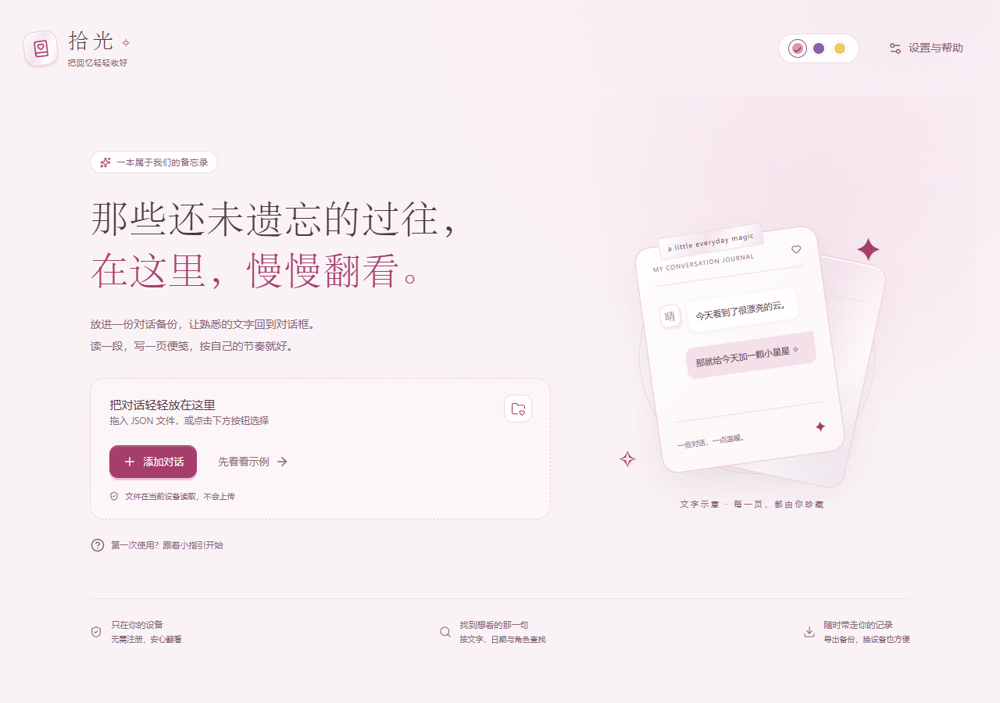
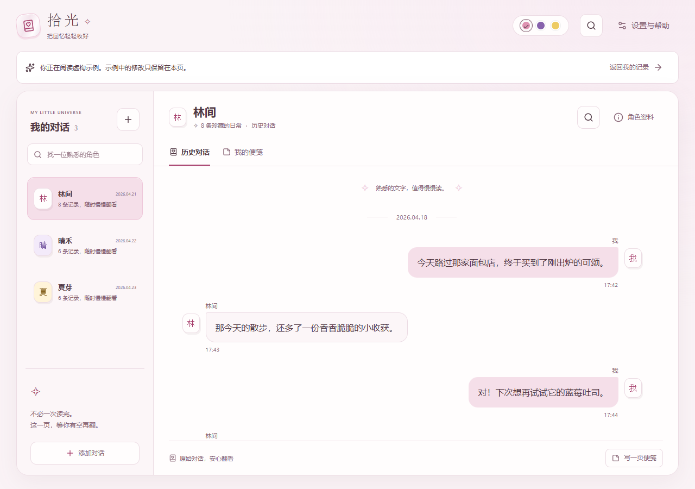
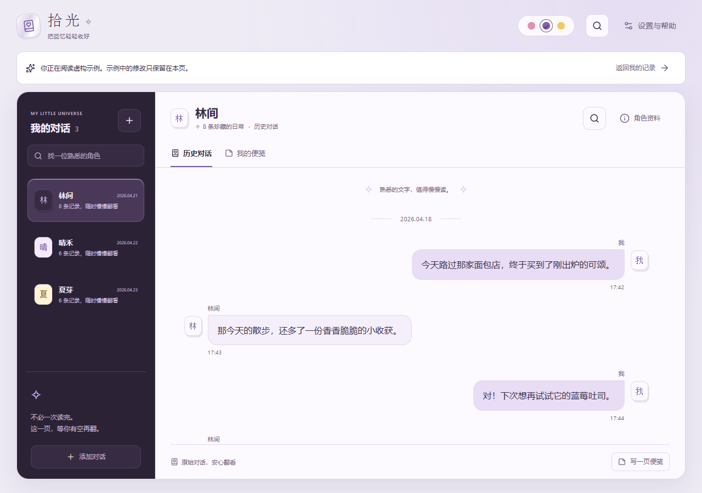
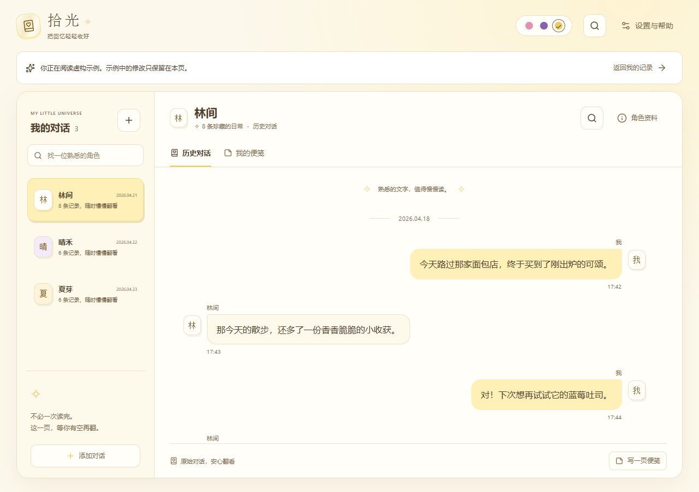
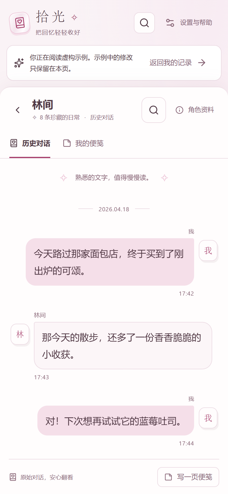
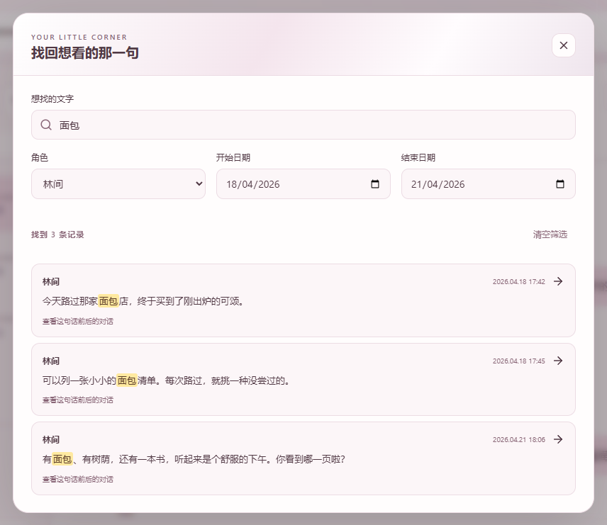
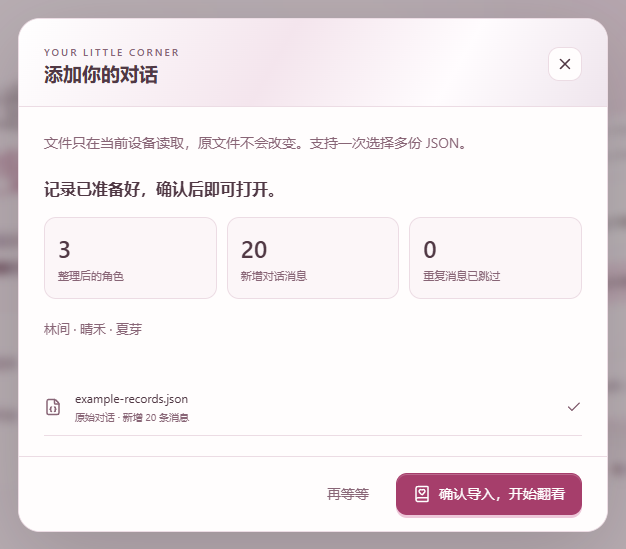
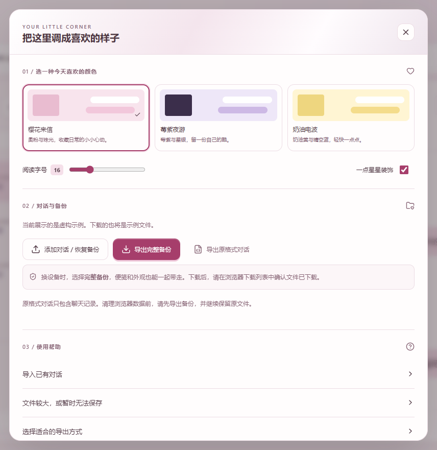
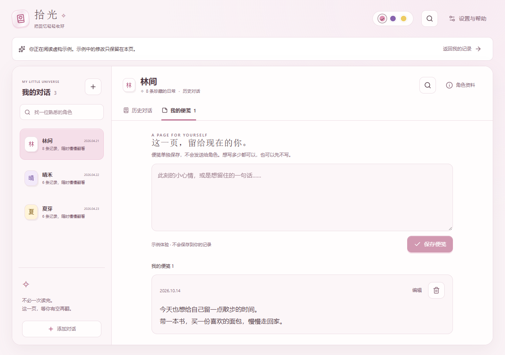

# 拾光

把已有对话整理成一本随时可以翻开的对话集。按角色、文字或日期寻找熟悉的片段，也可以为今天的自己留一页私人便笺。

可以选择樱花来信、莓紫夜游、奶油电波三种外观。初次打开时，可以先看看虚构示例，熟悉页面后再添加自己的对话；示例不会混入你的资料库。

以下界面截图均使用虚构示例，不包含真实用户的聊天记录。

## 翻阅与设置

- 在角色列表中选择一位角色，查看对应的历史对话。
- 使用文字搜索和日期筛选寻找片段；也可以按角色缩小范围。
- 在设置中调整外观，查看导入、备份与换设备的操作指引。
- 在“我的便笺”中写下自己的想法，再选择保存。便笺与原始聊天分开保存。

### 挑一种喜欢的颜色，慢慢翻看

樱花来信：柔和的粉色，陪你翻开熟悉的片段。

也可以随时在设置中换成莓紫夜游或奶油电波。

| 莓紫夜游 | 奶油电波 |
| --- | --- |
|  |  |

### 在手机上，也能随手翻一页

选择角色后即可阅读，想换一位时，返回角色列表就好。

### 找到想看的那一段

记得一句话、一个角色或大致的日期，都可以作为寻找的起点。

## 准备并导入对话

1. 如果还没有备份，在豆包的“设置 → 帮助与反馈 → AI 角色备份”中导出文件。
2. 如果得到的是 ZIP 压缩包，先右键选择“全部解压缩”或“解压”。打开解压后的文件夹，找到 `conversations.json`。
3. 选择“添加对话”，选中这个 JSON 文件。也可以一次选择多个 JSON 对话文件。
4. 查看识别出的角色和对话数量，确认后导入。看到保存成功的提示后，再开始浏览。

原始备份请继续保留。相同记录不会重复添加；发现内容冲突时，本次导入会停止，已有数据保持不变。如果提示保存失败，说明这次保存还没有完成，请保留原文件并按提示处理。

## 导入需要更多空间时

文件较大或一次选择较多文件时，会先提醒，你可以选择“继续尝试导入”，也可以少选几份文件。分批可减轻整理时的负担，但不会增加浏览器的保存空间。原文件不需要手动删改。

如果提示浏览器可用空间不足，这次内容尚未保存，原文件和之前保存的记录没有改变。先整理设备中不需要的其他文件，再选择“重试保存”；请先不要清除拾光的网站数据，以免影响已有记录和便笺。也可以选择“先返回，稍后再试”，之后重新选择原文件。

浏览器的保存限额和电脑剩余容量不完全相同。如果仍无法保存，可以在确认完整备份后换浏览器或设备。设备空间不足时，下载备份也可能暂时无法完成，请选择有空间且自己信任的位置，并在下载列表中核对。设置中的“文件较大，或暂时无法保存”提供了完整指引。

## 选择导出方式

在设置中选择导出，文件名会包含导出日期，方便辨认。导出不会删除当前浏览器中的内容。

| 导出方式 | 包含什么 | 适合什么时候使用 |
| --- | --- | --- |
| 原格式对话 JSON | 全部对话，保持原始对话备份格式；不含便笺和外观设置 | 单独留存对话记录 |
| 完整备份 JSON | 全部对话、私人便笺和外观设置 | 日常备份或换设备迁移 |

## 找到并留存下载文件

1. 导出后打开浏览器的下载列表，找到刚生成、名称带日期的 JSON 文件。
2. 选择“在文件夹中显示”或类似选项。通常文件在电脑的“下载”文件夹中；如果浏览器让你选择了保存位置，就到那个位置查找。
3. 确认文件已经下载，再复制一份到第二个可信位置，例如自己的 U 盘、移动硬盘或私人存储空间。

备份中有你的对话，完整备份还包含便笺，请不要放到公开共享的文件夹。如果下载列表中没有文件，先检查下载是否被取消或拦截，再重新导出。

## 换设备时迁移内容

1. 在旧设备的设置中导出“完整备份 JSON”，确认文件已经下载。
2. 通过自己信任的方式，把文件安全转移到新设备，并保留一份副本。
3. 在新设备打开工具，进入设置中的导入入口，选择这份完整备份。
4. 导入成功后，核对角色数量，打开几段对话，确认私人便笺和外观设置都在。
5. 确认内容完整后，再决定是否清理旧设备。原始备份和最近的完整备份请继续保留。

如果新设备已有记录，相同记录不会重复添加；发现冲突会停止本次导入，并保留现有数据。

## 私人便笺

原始对话不能改写。“我的便笺”用于单独保存自己的想法，不会添加进原始对话，不会发送给角色，也不会收到角色回复。写多少都可以，也可以先不写。

导出“完整备份 JSON”时会带上便笺；“原格式对话 JSON”不包含便笺。

## 内容保存在当前浏览器

对话和便笺默认保存在当前设备的当前浏览器中，文件在这里整理，不会上传。换一个浏览器或设备，不会自动出现这些内容。

**浏览器中的保存不能代替备份文件。**

清理网站数据、卸载浏览器、换设备或使用隐私模式，都可能让本地保存的内容不可用。建议在添加重要内容后导出完整备份，并复制到第二个可信位置；原始文件也请继续保留。

如果看到保存失败的提示，请先保留当前页面和原文件，按提示处理后再试。确认保存成功前，先不要清理原文件或旧设备。

## 常见问题

**为什么提示文件格式不支持？**

请确认选择的是对话备份 JSON（例如解压后的 `conversations.json`），或本工具导出的 JSON 备份。ZIP 压缩包不能直接导入，把其他文件改成 `.json` 也不会改变它的格式。如果文件仍无法读取，请保留原文件，尝试重新导出。

**为什么有的图片、语音、头像或角色介绍没有显示？**

能展示什么取决于备份实际包含什么。有些备份只有文字或附件信息，没有可显示的附件文件、头像或角色介绍。工具会保留可用记录，并说明缺少的内容；也不会自动访问备份中的远程附件地址。

**导入完整备份后，主题也会带过来吗？**

会。完整备份包含外观设置，导入成功后可以继续使用原来的主题，也可以再更换。原格式对话 JSON 不包含这些设置。

**同一份文件可以再次导入吗？**

可以。相同记录不会重复添加；如果同一条记录出现不同内容，会停止本次导入，保留已有数据，并提示存在冲突。

**私人便笺是发给角色的吗？**

不是。它只作为自己的便笺单独保存，不会发送给角色，也不会改变原始对话。

**提示保存失败后，需要再操作吗？**

需要，这次保存还没有完成。先保留原文件和当前页面，查看提示，确认浏览器允许保存数据、设备还有可用空间，再重试。看到保存成功前，不要把这次操作当作已经备份。

**软件里带有其他人的聊天吗？**

没有。项目只包含独立编写的虚构示例，不包含真实用户的聊天备份。你添加的记录只保存在自己的浏览器中。

## 许可与署名

拾光由 [ForOneIce](https://github.com/ForOneIce) 开发，项目原创内容采用 [Creative Commons 署名—非商业性使用—相同方式共享 4.0 国际许可协议（CC BY-NC-SA 4.0）](https://creativecommons.org/licenses/by-nc-sa/4.0/deed.zh-hans)。完整条款见 [LICENSE](LICENSE)。

分享、引用或改编本项目时，请署名 **拾光 · ForOneIce**，保留开发者与许可链接，并标明修改；不得用于商业目的。分享改编作品时，须遵守相同方式共享要求。署名可放在设置中的“关于”或文档等合理位置，无需出现在主页面。

第三方依赖遵循各自的许可。你导入的聊天、私人便笺及其他个人内容，不会因为使用本工具而自动采用本项目的许可，也不会因此公开或授权给开发者。
